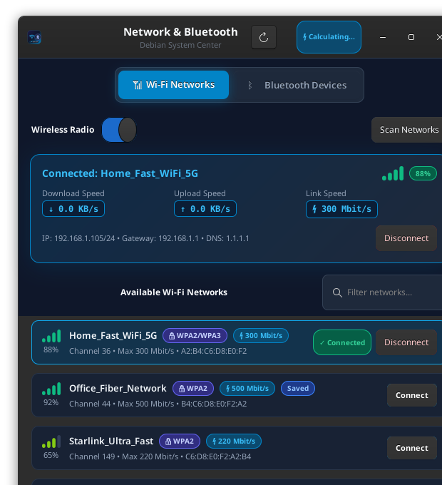
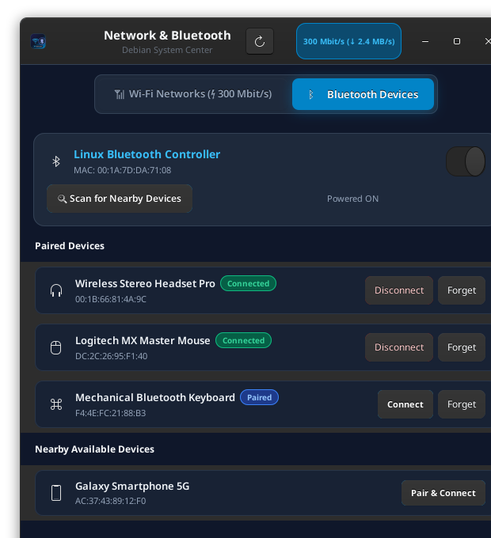
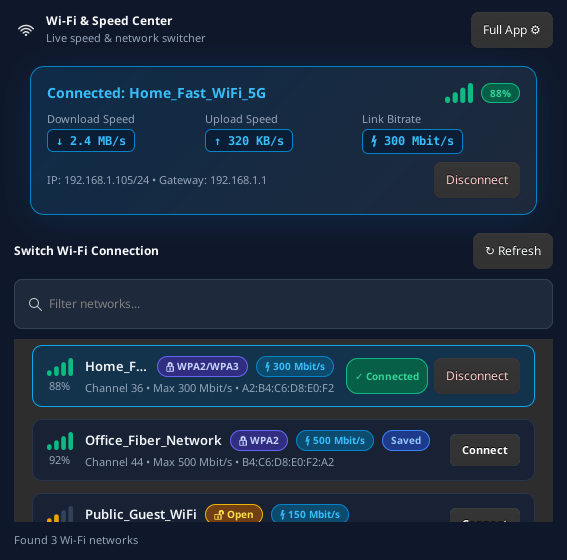

# 📶 Linux Wi-Fi & Bluetooth UI Manager

A modern, responsive, and lightweight GTK3 application for Linux (Debian, Ubuntu, Linux Mint, XFCE, GNOME) to manage Wi-Fi networks and Bluetooth devices with real-time throughput speed tracking, desktop shortcuts, and quick connection switching.

<div align="center">
  
</div>

---

## 📸 Screenshots

| 📶 Wi-Fi Manager | ᛒ Bluetooth Manager | ⚡ Quick Switch Dialog |
| :---: | :---: | :---: |
|  |  |  |
| *Wi-Fi scanning, signal strength bars, and live speed* | *Device pairing, audio headsets, and peripherals* | *Quick Wi-Fi switcher dialog with real-time throughput* |

---

## ✨ Features

- **📶 Wi-Fi Management**:
  - **Visual Signal Strength**: Dynamic 4-bar indicator with color transitions (Red ➔ Amber ➔ Lime ➔ Bright Green) and percentage readout.
  - **Speed Indicated on Every Option**: Each available Wi-Fi connection clearly displays its speed capability badge (e.g. `[ ⚡ 300 Mbit/s ]`, `[ ⚡ 500 Mbit/s ]`).
  - **Real-Time Speed & Throughput**: Displays physical bitrate (`300 Mbit/s`) and live download/upload throughput (`↓ 2.4 MB/s`, `↑ 320 KB/s`).
  - **Connection Details**: Displays active SSID, BSSID, IP address, Gateway, DNS, and Security type.
  - **One-Click Connection**: Connects to open or saved networks with a single click; includes password modal with eye-reveal toggle for encrypted networks (WPA2/WPA3).
  - **Controls**: Radio toggle switch (On/Off), network search filter, and manual rescan.

- **ᛒ Bluetooth Management**:
  - **Controller Status**: Controller name, MAC address, and master Power On/Off toggle.
  - **Scanning**: One-click device scan with animated progress indicator.
  - **Device Actions**: Connect, disconnect, and unpair/forget buttons for paired audio devices, mice, keyboards, and phones.
  - **Discovery**: Discovers nearby unpaired devices with instant "Pair & Connect".

- **⚡ Top Header Live Speed**:
  - Displays live speed right in the top header row next to the notification icon while the app is running.
  - Automatically cleans up and leaves zero background processes when closed.

---

## 🚀 Installation & Setup

### 1. Prerequisites (Debian / Ubuntu / Mint)

Ensure the required GTK3 and NetworkManager Python bindings are installed:

```bash
sudo apt-get update
sudo apt-get install -y python3 python3-gi gir1.2-gtk-3.0 network-manager bluez
```

---

### 2. Install the Software

Clone the repository and run the standard installer:

```bash
git clone https://github.com/thedhruvish/liunx-wifi-ui.git
cd liunx-wifi-ui
```

#### Option A: System-Wide Installation (Recommended)
Installs into `/opt/wifi-ui` and creates standard system command `wifi-ui`:

```bash
sudo ./install.sh
```

#### Option B: User-Space Installation (No `sudo` required)
Installs into `~/.local/share/wifi-ui` and `~/.local/bin/wifi-ui`:

```bash
./install.sh
```

---

## 🎮 How to Run

- **From Desktop**: Double-click the **Wi-Fi & Bluetooth Manager** icon on your Desktop.
- **From Applications Menu**: Find **Wi-Fi & Bluetooth Manager** under *Settings* or *Internet*.
- **From Terminal**:
  ```bash
  wifi-ui
  ```

---

## ⚙️ Automatic Startup (Launch on PC Boot / Login)

### User-Level Autostart (No `sudo` required)

To automatically launch the app when you log in:

```bash
mkdir -p ~/.config/autostart
cp /usr/share/applications/wifi-bluetooth-manager.desktop ~/.config/autostart/
```
*(If you installed with user-space `./install.sh`, use `cp ~/.local/share/applications/wifi-bluetooth-manager.desktop ~/.config/autostart/`)*

To disable autostart:
```bash
rm -f ~/.config/autostart/wifi-bluetooth-manager.desktop
```

---

### System-Wide Autostart (All Users - Requires `sudo`)

To make it automatically launch for all users upon booting into the desktop environment:

```bash
sudo cp /usr/share/applications/wifi-bluetooth-manager.desktop /etc/xdg/autostart/
```

To disable system autostart:
```bash
sudo rm -f /etc/xdg/autostart/wifi-bluetooth-manager.desktop
```

---

## 🔐 Permissions Note

- Running the application does **not** require `sudo`. NetworkManager (`nmcli`) and BlueZ (`bluetoothctl`) interact with system services over D-Bus via PolicyKit.
- Ensure your user belongs to the `netdev` and `bluetooth` groups:
  ```bash
  sudo usermod -aG netdev,bluetooth $USER
  ```

---

## 🗑️ Uninstallation

To remove the application and all installed shortcuts:

```bash
# If installed system-wide:
sudo ./uninstall.sh

# If installed in user-space:
./uninstall.sh
```

---

## 📁 Project Structure

```
wifi-ui/
├── main.py                     # Application entrypoint
├── app_window.py               # 2-Tab GUI (Wi-Fi & Bluetooth)
├── quick_dialog.py             # Quick Wi-Fi switch dialog
├── speed_indicator.py          # Top header speed widget
├── backend.py                  # nmcli & bluetoothctl backend
├── ui_widgets.py               # Signal bars, network cards, password modal
├── ui_style.py                 # Modern dark CSS stylesheet
├── install.sh                  # Standard Linux installer
├── uninstall.sh                # Clean uninstaller
├── wifi-bluetooth-manager.desktop  # Standard desktop entry
├── assets/                     # App icons and screenshots
└── README.md                   # Documentation and setup instructions
```

---

## 📄 License

MIT License. Free for personal and commercial use.
